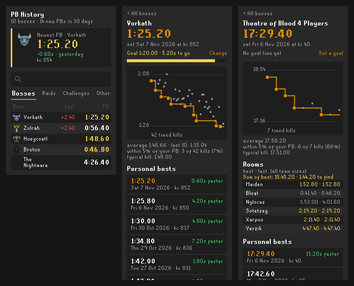
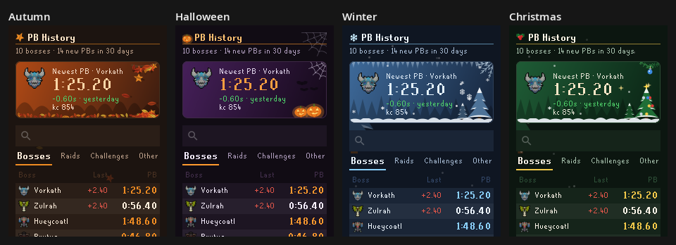

# PB History

Every personal best you set, **with the date you set it**, and every kill time: per boss, raid team size and mode,
and challenge.

- **Your newest PB** sits on a card at the top of the panel, with how much faster it was than the one before. If
  RuneLite's Screenshot plugin keeps boss kills, the card also shows **the screenshot of the kill that set it**.
  Older PBs get theirs with **Import PB pictures** at the bottom of the list (pick your `.runelite` folder, then Open).
- **A table of your PBs** (Boss · Last · PB), with each boss's icon. *Last* is your last kill against your PB: a
  green − is a new PB by that much, a red + is how much slower it was.
- **Tabs** for Bosses, Raids, Challenges (the Inferno, the Fight Caves, the Colosseum...) and everything else. The
  Raids tab splits the Chambers of Xeric, the Theatre of Blood and the Tombs of Amascut into their modes and team
  sizes, and has a tab for **The Fractured Archive** (one PB for every team size, as RuneLite's `!pb` keeps it).
- **Click a boss** for its graph: every timed kill as a dot, your PB as a line stepping down, and a mark where each
  new PB was set. Below it: your average and your last-10 average, and every PB you set with its date and kill count.
- **Combat Achievement speed tasks.** A badge after each boss shows the hardest speed-task tier your PB beats (H, E, M,
  GM; hollow = none yet), and the boss's page lists every tier's time with a tick where your PB beats it and how far
  off the next one is. Raids go by team size and mode, like the game's tasks. The times are the OSRS Wiki's; a tick
  means your PB beats the time, not that the game gave you the task (some tasks have more rules, like no slayer task).
- **A chat line after each kill** (bosses, raids, challenges): how far off your PB it was, where it ranks among your
  kills, and your average. After a new PB: by how much, and how far the next speed task is. *Line after each kill* in
  the settings turns it off.
- **Goal times.** Set a goal on a boss's page: a bar shows how close your PB is, and a chat line says *goal reached!*
  on the kill that beats it.
- **How consistent you are**: how many of your kills came within 5% of your PB, and your typical kill.
- **Raid rooms**: each room's best and last time, from the game's own room messages (in the Chambers of Xeric, from the
  CoX Timers in the *CoX Additions* plugin, as the game itself only times each floor; in The Fractured Archive, in the
  order of its stages). In the Theatre of Blood and the
  Tombs of Amascut, your **sum of best** too: your best time in every room added up, and how far it is from your PB —
  time you've already shown you can save.
- **Your PBs from before you installed it** are there from the start (without a date), so it isn't empty.

A **Theme** setting (Plain, RuneLite's own colours, by default) dresses the whole panel: the same themes as Death Log,
Flip Sidebar and Screenshot Gallery, from Dashboard to Infernal, and the seasons — Autumn, Halloween,
Winter and Christmas:

It uses RuneLite's own **Chat Commands** plugin (on by default): PB History keeps the PBs it saves, so the names and
times match RuneLite's `!pb` command. PB pictures need RuneLite's **Screenshot** plugin with *Screenshot boss
kills* ticked. If either is off, a card at the top of the panel says how to turn it on; PB History only reads those
settings and never changes them. Everything stays on your computer; it makes no network requests.

## Credits

Which new screenshot is a boss kill (its boss and kill count, from the game event that made RuneLite take it) follows RuneLite's own
Screenshot plugin (`ScreenshotPlugin`, Copyright (c) 2018, Lotto), used under RuneLite's BSD 2-Clause licence.

The Combat Achievement speed-task times come from the Old School RuneScape Wiki's Combat Achievements tables.

## Feedback

Something wrong, or an idea? Open an issue: https://github.com/bycoo222-cloud/pb-history/issues
